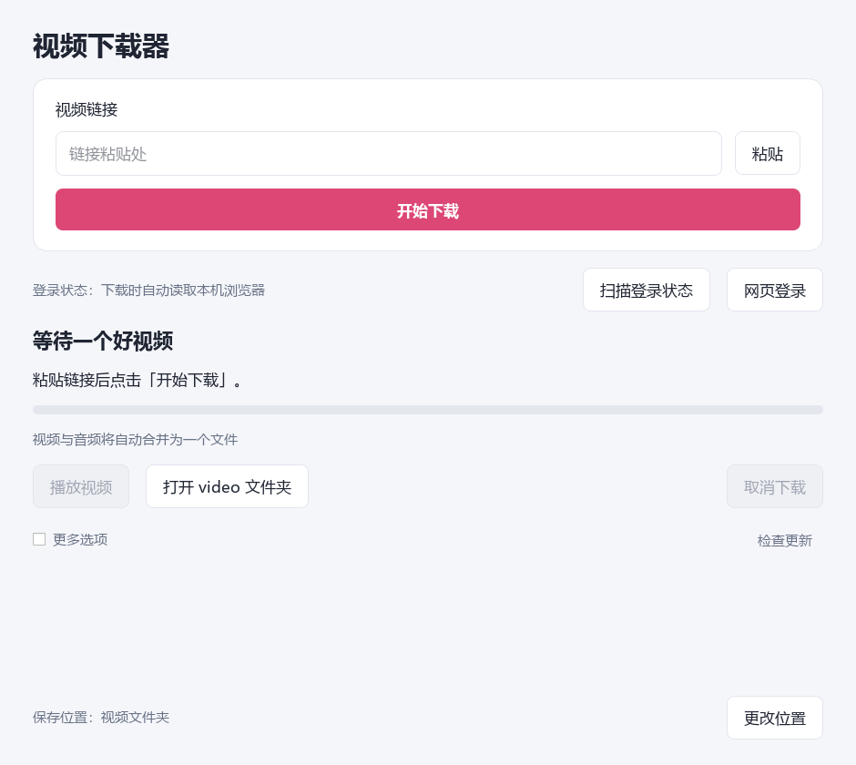

# 视频下载器

Qt 图形界面，粘贴链接即可自动识别 Bilibili、抖音和 X，保存当前权限下最高可用画质与音质。支持抖音图文、实况和背景配乐。

## 下载

- [Windows 安装包](https://github.com/WKing-1217/video-downloader/releases/latest/download/VideoDownloader-Windows-Setup.exe)：Windows 10 / 11 x64。
- [Android APK](https://github.com/WKing-1217/video-downloader/releases/latest/download/VideoDownloader-Android.apk)：Android 10+，ARM64 / x86_64。
- [最新版本与更新说明](https://github.com/WKing-1217/video-downloader/releases/latest)。

安装包内置运行环境和 FFmpeg，无需配置命令行。旧版安装到原目录即可升级。下载页使用固定文件名，仅保留最新安装包。

## 使用

粘贴视频链接或整段分享文字，点击“开始下载”。Windows 自动读取本机浏览器可用的站点登录状态，账号权限不足时也可在应用内网页登录；Android 使用应用内网页登录。完成后可以播放或打开文件夹。

视频、音频与完整时长通过检查后才显示完成。使用最多 8 连接及 B 站同格式备用节点，保持原画质、音质，支持断点检查；损坏的旧成品会单独保留并重新下载。

## 更新

两端启动时自动检查 GitHub 新版本，“更多选项”中可关闭。也可点击“检查更新”。Windows 下载更新后检查文件大小和 SHA-256，用户点击后启动原目录升级；进行视频下载时不会安装更新。Android 发现新版后打开 GitHub APK 下载链接，由系统确认安装。

更新检查只请求公开发布信息，不使用视频网站登录资料。网络不可用时不会打断视频下载。

## 源码与构建

- `bilibili/`：Qt Widgets / PySide6 桌面界面、下载核心和测试。
- `android/`：Qt Quick / C++ 界面、Android 前台下载服务。
- `bilibili/version.json`：版本号、Android 版本代码及发布仓库。
- `bilibili/packaging/`：Windows 打包、发布与第三方许可。

开发环境需要 Python 3.11+。桌面安装 `bilibili/requirements.txt` 及 PyInstaller，准备 FFmpeg、Inno Setup，再执行 `bilibili/packaging/build_windows.ps1`。Android 构建要求见 [Android 构建说明](android/README.md)。运行 `package_release.py` 整理最新产物、生成更新清单，再运行 `github_release.py publish` 发布到 GitHub。发布者认证通过本机 Git Credential Manager 完成。

检查命令：`python bilibili/smoke_test.py`、`python bilibili/test_parallel_http.py`、`python bilibili/test_updates.py`。真实安装包与联网验证记录见 [验证说明](docs/validation.md)。

第三方组件保留各自许可，完整文本和说明见 [第三方组件](bilibili/packaging/THIRD_PARTY.txt)。

