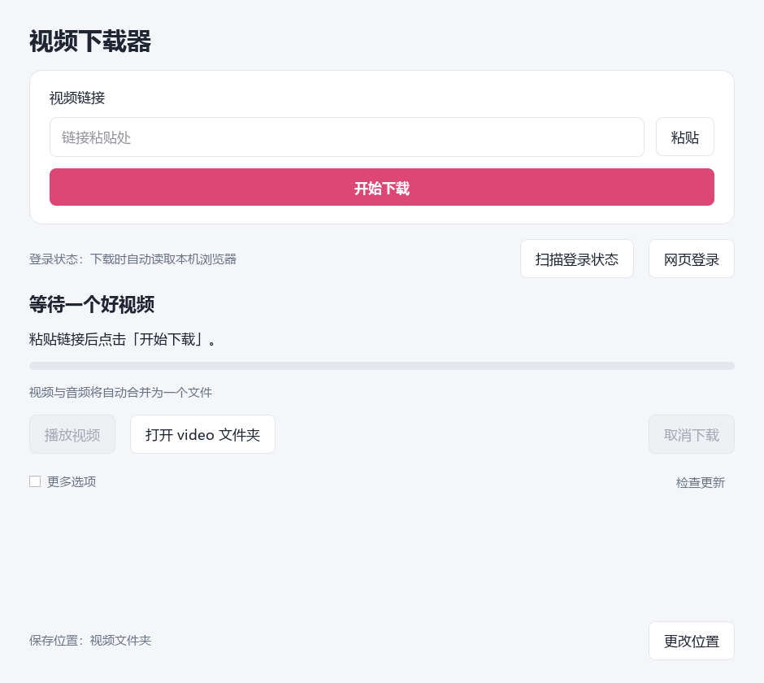
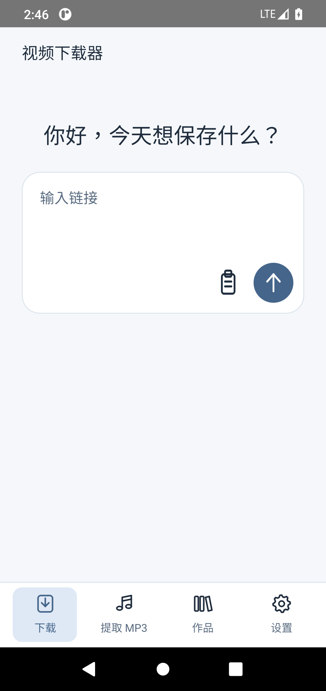

# 视频下载器

Android v1.0.6 优化状态栏、键盘、底部导航与播放器返回布局，加入作品库、删除、目录迁移和下载队列，补齐 Instagram 与 YouTube / Shorts，修复抖音实况下载。Windows 提供 v2.1.5，支持同一套核心平台、MP3 提取与导出格式设置。完成校验后保存，新导出只保留媒体文件。

## 下载

- [Windows 安装包](https://github.com/WKing-1217/video-downloader/releases/latest/download/VideoDownloader-Windows-Setup.exe)：Windows 10 / 11 x64，内置运行环境、FFmpeg、播放与网页登录组件。
- [Android APK](https://github.com/WKing-1217/video-downloader/releases/latest/download/VideoDownloader-Android.apk)：Android 10+，ARM64 / x86_64，v1.0.6。
- [最新版本与更新说明](https://github.com/WKing-1217/video-downloader/releases/latest)。

安装到原目录即可升级，无需卸载。Windows 与 Android 分别记录实际版本，固定安装包文件名；历史正式 Release 保留供恢复。

## 使用

在下载页输入框 Ctrl+V、右键粘贴或点击粘贴填入链接，点击右侧深蓝灰箭头或按回车验证并排队。粘贴只填入，不会监听整个系统剪贴板；同一链接不会重复创建任务。

左侧依次提供下载、提取 MP3、我的视频、软件更新；点击顶部 Logo 展开完整侧栏，可拖动调整宽度。长标题边缘渐隐，从右向左单向循环。顶部搜索或 Ctrl+K 打开独立搜索窗口，关闭后回到原页面。

“提取 MP3”页支持提交链接或选择本地视频；视频库的 MP3 按钮、右键菜单和视频播放窗口也可提取已有视频的音轨。原视频保留，同名文件自动另存。下载页与提取页各自保留输入、错误、进度和重试状态，切换页面不会丢失。MP3 与图文配乐使用 Windows 默认播放器打开。

设置中可选导出格式：视频默认 MP4，可选 MKV、MOV、WebM；图片默认 PNG，可选 JPEG、WebP；MP3 可选 128、192、256、320 kbps，默认 192。新导出不生成 JSON 附件，作品信息保存在程序内部；旧 JSON 仍兼容读取。下拉框不再响应滚轮切换，滚轮继续滚动页面，点击和键盘选择正常。

Android 使用下载、提取 MP3、作品、设置四个等宽入口，保留各页输入和状态；可连续添加链接排队，也支持选择本地视频提取 MP3。作品库可搜索、查看、分享及删除，图文可逐项打开或删除，实况以独立视频保存。在设置中选择授权文件夹后，已有作品会校验迁移，同名文件另存；仅清理登记的旧文件，保留其他文件。手机通过系统媒体播放器打开成品。

“我的视频”自动导入原保存目录，支持搜索、排序、内置播放及视频/图文删除，图文可单张删除，删除前确认。播放器和图片查看器使用独立窗口，可最小化、最大化并正常切回视频库。首次安装可选择保存位置；设置或视频库底部可更改目录，原作品会自动迁移，校验后清理旧文件和空目录，其他个人文件保留。

登录、浏览器账号扫描、登录来源、更新偏好与日志在左下角设置内，窗口可手动调整大小。浏览器信息受加密保护时会显示真实状态，可使用程序内网页登录。不同站点账号不会混用，登录值不写进日志或视频记录。

## 更新

启动后台读取实际 GitHub Releases。无更新不打扰；发现新版可暂不更新，或者进入“软件更新”查看真实说明与下载进度。支持四连接、可靠范围续传、有限重试、取消和 SHA-256 校验；未知大小使用不确定进度。

点击安装并确认后，独立助手备份原程序与设置，退出旧程序、执行安装并验证新版启动；失败时恢复。视频与网页登录资料保留。网络不可用不影响下载页，可重试或打开官方 Releases，不使用未知第三方加速源。

## 源码、构建与验证

- [桌面使用和构建说明](bilibili/README.md)
- [v2.1.4 MP3、导出格式与页面验收](bilibili/EXPORT_REVIEW.md)
- [本次发布验收](docs/validation.md)
- [v2.1.3 目录、删除、侧栏与窗口验收](bilibili/STORAGE_REVIEW.md)
- [v2.1 界面与发布验收](bilibili/UI_REVIEW.md)
- [v2 修改清单、20 条验收与实际边界](bilibili/V2_DELIVERY.md)
- [Android 构建说明](android/README.md)
- [Android 1.0.6 界面与功能验收](android/UI_PARITY_REVIEW.md)
- [第三方组件许可](bilibili/packaging/THIRD_PARTY.txt)

桌面推荐标准 CPython 3.12 x64，安装 bilibili/requirements.txt、PyInstaller，准备 FFmpeg 与 Inno Setup 6 后执行 bilibili/packaging/build_windows.ps1。版本与发布仓库在 bilibili/version.json。

Windows 源码验证包含 120 项单元检查、32 项下载内核冒烟、27 项 MP3 流程、26 项原界面流程，以及 100% / 150% 各 47 项界面检查。独立 EXE 另通过 47 项实际检查，安装及独立更新助手验证保留视频、设置、登录资料与历史记录。Android 已通过 x86_64 模拟器的真实文件选择、前台服务提取、系统媒体保存、11 项格式/码率组合、设置重启保留及取消检查；APK 包含 ARM64 与 x86_64，签名与旧版一致。成品验收和具体边界见本次发布验收。

在线 MP3 的 Bilibili 公开链接测试被站点 HTTP 412 拒绝，尚未完成在线下载验收；链接音轨选择及转换已用受控解析器和真实 FFmpeg 验证，本地 MP4 提取已实测。抖音与 X 的真实在线 MP3 尚未实测。Android ARM 实机、Windows 10 实机、双屏热切换和长期大规模媒体库压力测试尚未覆盖。

## Instagram 与 YouTube（Windows 2.1.5）

新增 Instagram Reel/单视频帖子、YouTube 普通视频/Shorts/youtu.be 单条链接识别；沿用原下载队列、取消、重试、MP4/MP3 导出及视频库。分享追踪参数会清除，同一视频不同链接去重。频道、播放列表、直播和 Instagram 图片/轮播尚不在本次验收范围。

Windows 安装包内置 Node.js 与匹配的 yt-dlp-ejs 脚本，无需另装 JavaScript 环境；源码运行使用 `yt-dlp[default]` 与 Node.js 22+（或 Deno），本地 Node 可放在 `bilibili/tools/node.exe`，也可加入 PATH。Windows 下载尊重系统代理；网页登录与浏览器读取继续按站点隔离。

Instagram 公开响应有时省略时长，下载传输完成后读取实际媒体时长并完整解码，验证后再导出。平台明确返回无音轨的视频可保存为无声视频，完成状态会说明；不伪造音轨，无音轨不能提取 MP3。Windows实际导出结果见 [新增平台验收](bilibili/SOCIAL_REVIEW.md)。Android 1.0.6已另行完成这两个平台的真实下载、公共媒体保存和解码检查，使用内置QuickJS与EJS，无需另装JavaScript环境。
